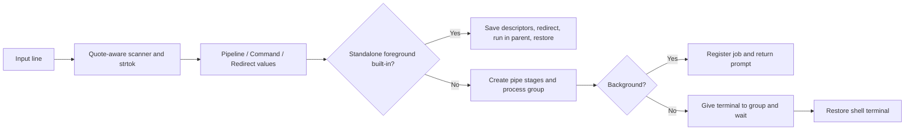

# Design walkthrough

Read this alongside the code in this order: `utils/parser.h` → `utils/parser.cpp` → `Main.cpp` → `system/system.cpp` → one built-in. The project has one thread. Concurrency comes from child processes.

## 1. Turn text into an execution plan

For this input:

```sh
cat < input.txt | head -n 3 > output.txt & echo launched
```

`parseLine()` produces two pipelines. The first has two commands and is marked background. `cat` has an input redirect; `head` has an output redirect. The second pipeline is a standalone foreground `echo`.



The scanner distinguishes words from operators, even when a quoted word looks like `|`. It tracks empty quoted words and whether a leading tilde was unquoted. Ordinary spans use `strtok`; quotes and operators are handled separately. `strtok` modifies its buffer and maintains internal state, so it is only used with owned temporary strings in this single-threaded scanner.

The parser validates the whole line before execution. Keeping parsing free of process/file operations means malformed input cannot launch half of a line or truncate a redirect target. Tilde expansion reads the fixed launch-home setting; it does not consult changing cwd or `PWD`.

Interactive input uses Readline. Batch input reads exactly one line through `read`, without buffering ahead: an external command such as `cat` must be able to consume any remaining stdin bytes itself.

## 2. Choose where a built-in runs

A process has its own working directory. A child calling `chdir` cannot change its parent's directory. Consequently a standalone foreground `cd` must run inside the shell process. `exit`, history display, and the other built-ins use the same parent path.

For parent built-ins, `StandardStreams` uses `dup` to save stdin/stdout, then `dup2` installs redirects. Its destructor flushes buffered output, restores both descriptors, and closes the saved copies. This also runs if a built-in throws. Failed redirection prevents the built-in from executing.

A pipeline or background command needs a child context. Built-ins in that context execute after descriptor setup and terminate with `_exit`. Their directory/exit changes remain local to that process. Buffered C++ output is explicitly flushed before `_exit`.

## 3. Build a pipeline without serializing it

For `producer | filter | consumer`, the executor forks **all three stages before waiting**. Waiting immediately after the producer fork could deadlock once its pipe fills and no consumer is running.

Only the previous pipe's read end and the next pipe are kept while launching stages. This rolling approach avoids opening every pipe up front. Each child connects its required endpoints using `dup2`, closes the originals and every unused pipe end, then applies explicit redirects. The parent closes write ends immediately after each fork and closes the previous read end as it advances.

Pipe EOF is based on open write descriptors, not whether the writer you expected has exited. Leaving a write end open in any process can keep `cat` waiting forever. Closing the consumer side matters too: if the consumer exits early, producers should receive SIGPIPE rather than hang.

External programs are launched by `execvp`, which searches `PATH` when appropriate and replaces the child process image. Failure prints a diagnostic and calls `_exit(127)` for ENOENT or `_exit(126)` otherwise. The parent shell continues.

## 4. Give each job one process group

A `Job` is one pipeline, with a process-group ID and one `Process` record per stage. Each record tracks PID, exit/wait status, stopped state, and completion. A finished stage does not imply that the whole pipeline has finished.

Both child and parent call `setpgid` to establish membership despite scheduling order. Children wait at a launch-gate pipe. The parent creates every stage, records their PIDs, assigns the foreground terminal group when needed, then closes the gate's write end. EOF releases all children. This keeps a fast first stage alive until the remaining stages join its group and prevents programs from reading the terminal before handoff.

The shell retains a separate close-on-exec terminal descriptor, so redirecting a parent built-in's stdin cannot remove its ability to control the terminal. `tcsetpgrp` switches the terminal foreground group; `tcgetattr`/`tcsetattr` preserve shell modes. Stopped jobs retain their own terminal modes for `fg`.

Foreground waiting uses `waitpid(-1, ..., WUNTRACED | WCONTINUED)` and routes each returned PID to either the foreground job or its registered background job. Collecting background statuses here prevents zombies from accumulating during a long foreground command. Waiting continues until all foreground stages finish or every remaining foreground stage is stopped. The terminal is then returned to the shell. The final stage's wait status determines the pipeline status.

## 5. Handle signals outside the handler

The shell ignores SIGTSTP and SIGQUIT, and ignores SIGTTIN/SIGTTOU while managing its terminal. Children reset these dispositions, plus SIGINT, SIGCHLD, and SIGPIPE, before executing programs.

The terminal sends Ctrl-C/SIGINT and Ctrl-Z/SIGTSTP to its **foreground process group**. The shell gives that role to a foreground job, so all pipeline stages receive the signal together. Ctrl-Z stops a pipeline; it does not make it continue running. `bg` sends SIGCONT without terminal handoff; `fg` gives the group the terminal before sending SIGCONT.

The SIGCHLD handler only changes a `volatile sig_atomic_t` flag. It never uses `cout`, allocates memory, or waits. `reapBackground()` checks registered background PIDs with nonblocking `waitpid`, updates their states, prints notifications, and removes completed jobs. It runs between commands and from Readline's event hook while input is idle. During foreground work, the foreground wait loop collects and routes background statuses too; their notifications are deferred until control returns to the prompt.

Using explicit background PIDs prevents background cleanup from stealing a status needed by the foreground waiter. No signal-mask lock is needed for registration: the signal handler never touches the job list or calls `waitpid`.

At an empty prompt Ctrl-D makes Readline return null. At a nonempty prompt it follows Readline's editing behavior. It is an EOF input condition, not a signal. Ctrl-C at the prompt sets another flag; the event hook clears the edit buffer and redisplays the prompt.

## 6. Keep built-ins understandable

- `cd`: capture cwd, validate the target, call `chdir`, update the previous directory only on success.
- `pwd`: call `getcwd` and print an absolute path. Prompt formatting is a separate concern.
- `ls`: parse flags/operands, collect metadata with `lstat`, sort entries, calculate column widths, print permissions/owners/sizes/timestamps. `lstat` preserves information about symbolic links. Short-form directory symlink operands may be followed to list their contents.
- `pinfo`: read `/proc/<pid>/stat` for state and terminal group, `/status` for `VmSize`, and `/exe` using `readlink`. The command-name field in `stat` can contain spaces and parentheses, so parsing starts after its last closing parenthesis.
- `search`: use an explicit stack for depth-first traversal and `lstat` to avoid following directory symlinks. Memory tracks pending directories rather than C++ call-stack depth. Unreadable subtrees report diagnostics and are skipped.
- `history`: retain a twenty-entry deque, seed Readline history at startup, validate counts without throwing, save complete data through a private temporary file and atomic rename. Rename avoids publishing a partially written file; it does not provide an fsync-based power-loss guarantee or merge concurrent sessions.

## 7. Resource and error ownership

| Resource | Owner and cleanup |
| --- | --- |
| Readline input allocation | `Main.cpp` frees it after copying the line |
| Saved standard descriptors | `StandardStreams` destructor |
| Rolling pipe ends and launch gate | Parent/child launch branches close their respective copies |
| Child status | Foreground waiter or background job tracker, never both |
| Terminal ownership | Executor restores shell group/modes after waiting and at destruction |
| Directory streams | Each built-in/completion scan calls `closedir` |
| History temporary file | Save routine closes it, renames on success, unlinks on failure |

A partial launch failure closes pipe ends, kills the group already created, and waits for those children. Invalid numeric arguments use `from_chars`, which reports errors without throwing. PID and count overflow are rejected. `/proc` information is inherently a snapshot; the process may exit between reads.

## 8. Validation strategy

Parser tests focus on boundaries that are easy to break: no spaces around operators, quoted operators, empty arguments, token concatenation, leading tilde rules, and invalid structures. Integration tests use temporary directories and explicit history locations to check externally observable behavior. Large output and `yes | head` expose descriptor and scheduling errors that small happy-path pipes miss.

PTY tests are separate because ordinary redirected stdin cannot reproduce terminal process groups, Ctrl-C/Ctrl-Z delivery, Readline completion, or arrow keys. `forkpty` gives the shell a real controlling pseudo-terminal, and the tests send the same control bytes a keyboard would send. This catches terminal handoff failures and validates nested shell operation.
